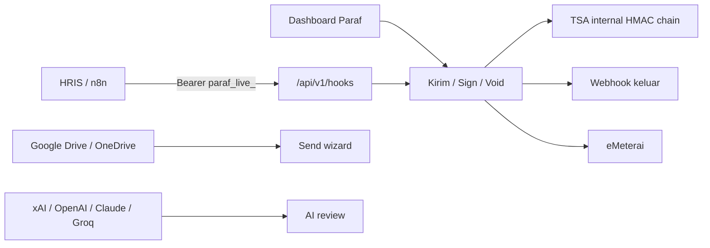

# Paraf

Tanda tangan digital + eMeterai untuk dokumen Indonesia. Setiap workspace punya inbox, alur kirim/tanda tangan, stempel eMeterai, jejak audit, timestamp (TSA) internal, dan konektor plug-and-play (webhook, BYOK, AI, Drive).

Dokumen ini adalah peta implementasi: **apa yang sudah ada, di mana kodenya, bagaimana alurnya**. Pakai ini dulu sebelum menambah fitur.

---

## Isi

1. [Stack](#stack)
2. [Peta modul](#peta-modul)
3. [Alur inti](#alur-inti)
4. [Konektor plug-and-play](#konektor-plug-and-play)
5. [REST API HRIS/ERP](#rest-api-hriserp)
6. [Model data](#model-data)
7. [Peta file](#peta-file)
8. [Auth](#auth)
9. [Deploy (Docker)](#deploy-docker)
10. [Variabel lingkungan](#variabel-lingkungan)
11. [Cara menambah fitur](#cara-menambah-fitur)

---

## Stack

| Lapisan | Pilihan |
|---|---|
| UI | React 19, TanStack Router / Start / Query / Table, Tailwind v4, Radix |
| Auth | Better Auth (email/password + Google/X via broker) |
| Data | Postgres (`DATABASE_URL`) atau PGLite in-memory (preview tanpa DB) |
| Server | `createServerFn` di `src/lib/*.ts`, route file di `src/routes/` |
| i18n | `id` / `en` di `src/lib/i18n.ts`, toggle di header |
| Crypto | Web Crypto (`src/lib/crypto-lite.ts`) — HMAC-SHA256, SHA-256 |

Preview lokal: `npm run dev` (melalui `scripts/with-app-env.mjs`). Production Node: `NITRO_PRESET=node_server` lalu `node .output/server/index.mjs`.

---

## Peta modul

Rail kiri (`src/components/app-shell.tsx` → `MODULES`):

| Modul | Route | Fungsi |
|---|---|---|
| **Documents** | `/esignature/:folder` | Inbox, KPI, search, folder status, aksi dokumen |
| **Approvals** | `/approvals` | Layer persetujuan, decide approve/reject |
| **Contracts** | `/contracts` | Kontrak yang di-track (`settings.trackAsContract`) |
| **Templates** | `/templates` | Template isi + field, kirim dari template |
| **eMeterai** | `/emeterai` | Kuota, assign ke anggota, request stempel, konektor |
| **Contacts** | `/contacts` | Penerima tersimpan, kirim ke kontak |
| **Developer** | `/webhooks`, `/byok` | Webhook keluar, BYOK, API key inbound, AI key |
| **Settings** | `/settings`, `/stamps` | Profil, kuota, tanda tangan, stempel, notifikasi, integrasi |

Halaman lain yang tidak di rail:

| Halaman | Route | Fungsi |
|---|---|---|
| Kirim / unggah | `/send` | Wizard 5 langkah |
| Request eMeterai | `/send?intent=emeterai` | Wizard dengan stempel eMeterai |
| Bulk | `/bulk` | Kirim / tanda tangan massal |
| Detail dokumen | `/documents/:id` | Isi, penerima, audit, TSA |
| Tanda tangan (login) | `/documents/:id/sign` | I agree → Start signing → Finish |
| Tanda tangan publik | `/s/:token` | Link penerima tanpa akun |
| Proofs / TSA | `/proofs` | Ledger timestamp workspace |
| AI review | `/ai` | Review klausul (butuh API key) |
| Insights | `/insight` | Agregat signing |
| Verify publik | `/verify?token=&serial=` | Cek dokumen, eMeterai, serial TSA |
| Login | `/login` | Sign in / sign up |

### Folder inbox

URL `/esignature/:folder` — mapping di `FOLDER_ROUTES` (`src/lib/types.ts`):

`all-inbox` · `need-to-sign` · `waiting-for-others` · `expiring-soon` · `completed` · `drafts` · `sent` · `scheduled` · `trash` · `shared` · `declined` · `expired` · `voided` · `pending-approval`

Filter **Need to sign** memakai peran *aktor* (penerima = user yang login), bukan hanya status dokumen.

### Aksi dokumen

`mutateDocument` (`src/lib/api.ts`): `void` · `delete` (soft → trash 7 hari, hapus permanen) · `restore` · `remind` · `duplicate` · `move` · `resend`.

Download (header): dokumen, jejak audit, lampiran, sertifikat penyelesaian — `src/lib/download.ts`.

---

## Alur inti

### 1. Kirim dokumen (wizard)

Komponen: `src/components/send-wizard.tsx`  
Route: `src/routes/_app/send.tsx`

```
Dokumen → Penerima → Kolom → Pengaturan → Tinjau → Kirim
```

| Langkah | Yang terjadi |
|---|---|
| Dokumen | Tipe (PKS, NDA, SK, sewa, …), judul, atau impor Google Drive / OneDrive / file teks |
| Penerima | Nama, email, peran (`signer` / `cc` / `approver` / `witness` / `notary`), urutan |
| Kolom | Drag field: signature, initials, date, name, email, text, checkbox, stamp, emeterai, QR, … |
| Pengaturan | Sequential/paralel, WhatsApp, reminder, QR, passcode, jadwal kirim, eMeterai by maker/signer, PSrE vs GlobalSign |
| Tinjau | Simpan draf atau kirim. Kirim → status `waiting_for_others` / `need_to_sign`, TSA seal, webhook `document.sent` |

Query string:

- `?template=<id>` — preload template
- `?toEmail=&toName=` — preload penerima dari kontak
- `?intent=emeterai` — mode request eMeterai

### 2. Tanda tangan

Komponen: `src/routes/_app/documents.$id.sign.tsx` + `src/components/sign-pad.tsx` + `src/components/document-paper.tsx`

```
Buka dokumen → I agree → Start signing → klik field → pad tanda tangan → Finish
```

- Tanda tangan tersimpan di `signatures` (bisa dipakai ulang).
- Field eMeterai diisi lewat `issueEmeterai` jika kuota / konektor siap.
- Finish memanggil `applySignature` → audit + TSA `document.signed` / `document.completed` + webhook.
- Penerima eksternal: `/s/:token` (`src/routes/s.$token.tsx`) → `publicSign`.

### 3. eMeterai

| Mode | Kapan | Hasil |
|---|---|---|
| **DEMO** | Belum ada URL+token provider | Serial internal, `legal: false`, dokumen tetap bisa dikirim |
| **Live** | Env `EMETERAI_API_URL` + `EMETERAI_API_TOKEN`, atau tempel di Settings / eMeterai | POST ke provider, `legal: true` jika 2xx |

Kode: `src/lib/emeterai.ts`, server fn `saveEmeteraiConnector` / `testEmeteraiConnector` / `issueEmeterai` / `lookupEmeterai`.

Kuota di tabel `quotas`, assign ke `team_members`. Beli kuota: `buyEmeterai`.

Verifikasi publik: `/verify?serial=…`.

### 4. Persetujuan

`requestApproval` menaruh layer di `approvals`. Approver decide di `/approvals` → webhook `approval.requested` / `approval.decided` + TSA.

### 5. Template & bulk

Template = `content_json` + `fields_json`. **Create / Send** dari `/templates` membuka wizard dengan `?template=`.  
`/bulk` memakai template yang sama untuk banyak penerima (`bulkSignDocs`).

---

## Konektor plug-and-play

Pola yang sama di semua konektor: **tempel kredensial → Test connection → dipakai otomatis**. Tanpa kredensial = DEMO, alur UI tidak berubah.



| Konektor | UI | Env | File |
|---|---|---|---|
| eMeterai | eMeterai / Settings | `EMETERAI_API_URL`, `EMETERAI_API_TOKEN`, `EMETERAI_PROVIDER` | `src/lib/emeterai.ts` |
| Webhook keluar | Developer → Webhooks | `PARAF_WEBHOOK_URL`, `PARAF_WEBHOOK_SECRET` | `src/lib/integrations.ts` |
| BYOK signing | Developer → BYOK | `PARAF_BYOK_SECRET` | `src/lib/byok.ts`, `src/lib/tsa.ts` |
| API key inbound | Developer → BYOK → Create key | — (disimpan hash di `api_keys`) | `src/lib/integrations.ts` `userIdFromApiKey` |
| AI review | Settings / `/ai` / BYOK | `XAI_API_KEY`, `OPENAI_API_KEY`, `ANTHROPIC_API_KEY`, `GOOGLE_AI_API_KEY`, `GROQ_API_KEY`, `AI_API_URL` | `src/lib/ai-providers.ts` |
| Google Drive | Wizard unggah | Grok app-data gate (login Google) | `searchGoogleDrive` / `importCloudFile` |
| OneDrive | Wizard unggah | token Graph di prefs | `saveOneDriveToken` |
| TSA | Proofs, detail dokumen, `/verify` | secret workspace atau BYOK | `src/lib/tsa.ts` |

### Webhook keluar

Event (`WEBHOOK_EVENTS`):

`document.sent` · `document.signed` · `document.completed` · `document.declined` · `document.voided` · `document.reminded` · `approval.requested` · `approval.decided`

POST JSON ke URL workspace. Header: `X-Paraf-Signature` (HMAC-SHA256 body). Event selalu dicatat di **Event stream** (`workspace_events`) meskipun URL belum diisi.

**Send test event** dan **Ping** ada di `/webhooks`.

### TSA internal

Bukan TSA BSrE pihak ketiga. Chain HMAC di dalam Paraf:

- Policy `paraf-tsa-v1` (secret workspace) atau `paraf-byok-v1` (kunci BYOK)
- Setiap send / sign / void / remind / approval → `issueWorkspaceTsa` (di-await, bukan fire-and-forget)
- Serial + prev hash + MAC, verifikasi di `/verify` dan `GET /api/v1/tsa/:serial` (publik)

### Google Drive / OneDrive

Impor mengisi `DocContent` lewat `contentFromImportedFile` (`src/lib/doc-helpers.ts`) — teks dipecah jadi klausul, bukan hanya nama file.

---

## REST API HRIS/ERP

Auth: `Authorization: Bearer paraf_live_…` (buat di Developer → BYOK).  
Spec hidup: `GET /api/v1/openapi`.

| Method | Path | Isi |
|---|---|---|
| GET | `/api/v1/me` | Identitas workspace |
| GET | `/api/v1/documents` | Daftar dokumen |
| POST | `/api/v1/documents` | Buat; `send: true` langsung kirim |
| GET | `/api/v1/documents/:id` | Detail + serial TSA |
| POST | `/api/v1/documents/:id` | `{ action: "void" \| "remind" }` |
| GET | `/api/v1/events` | Log delivery webhook |
| GET/POST | `/api/v1/hooks` | Inbound HRIS: `document.create` / `sent` / `void` / `remind` |
| GET | `/api/v1/tsa` | Rantai timestamp workspace |
| GET | `/api/v1/tsa/:serial` | Verifikasi publik (tanpa auth) |

Contoh inbound:

```json
{
  "event": "document.create",
  "data": {
    "title": "HRIS offer letter",
    "send": true,
    "recipients": [{ "name": "Ada", "email": "ada@co.id" }]
  }
}
```

Respons 201: `{ id, token, signingUrl, event }`. Helper: `src/lib/v1.ts`.

---

## Model data

Migrasi: `migrations/0001_auth.sql` (Better Auth) · `0002_schema.sql` · `0003_parity.sql` · `0004_workspace.sql`.  
Tabel integrasi dibuat lazy di `ensureIntegrationTables()`.

**Inti**

- `companies`, `quotas`, `folders`, `workspace_prefs`, `team_members`
- `documents` — `content_json`, `fields_json`, `settings_json`, `token`, status, jadwal, trash
- `recipients` — peran, urutan, status, `signature_data`
- `signatures`, `stamps`, `templates`, `contacts`, `contact_groups`
- `approvals`, `approval_templates`
- `audit_events`, `notifications`, `emeterai_orders`, `signing_proofs`

**Integrasi**

- `webhooks`, `webhook_deliveries`, `workspace_events`
- `api_keys` (hash SHA-256, prefix `paraf_live_`)
- `tsa_tokens`, `tsa_heads`

### Status dokumen

`draft` · `need_to_sign` · `waiting_for_others` · `pending_approval` · `scheduled` · `completed` · `declined` · `expired` · `voided`

### Tipe field

`signature` · `initials` · `date` · `name` · `email` · `text` · `checkbox` · `stamp` · `emeterai` · `qr` · `title` · `company` · `phone` · `currency` · `number` · `radio`

---

## Peta file

```
src/
  components/
    app-shell.tsx          # chrome: header oranye, rail, folder, suite
    inbox-view.tsx         # tabel inbox + KPI + filter
    send-wizard.tsx        # 5 langkah kirim
    document-paper.tsx     # kertas + field interaktif
    sign-pad.tsx           # canvas tanda tangan
    getting-started.tsx    # onboarding
  lib/
    api.ts                 # hampir semua server fn dokumen
    types.ts               # status, field, settings, folder routes
    doc-helpers.ts         # blankContent, pageCount, import file
    seed.ts                # dokumen contoh per workspace baru
    emeterai.ts            # konektor eMeterai
    tsa.ts                 # seal / verify HMAC
    byok.ts                # load signing key
    ai-providers.ts        # multi-provider chat
    integrations.ts        # webhook dispatch, Drive, API key, TSA issue
    integrations-api.ts    # server fn Settings / Developer
    v1.ts                  # auth Bearer REST
    download.ts            # HTML sertifikat / audit
    i18n.ts + lang.ts      # copy ID/EN
    db.ts                  # Postgres / PGLite
    auth/                  # Better Auth — jangan diubah kecuali email-password.ts
  routes/
    _app/*                 # halaman setelah login
    api/v1/*               # REST
    s.$token.tsx           # tanda tangan publik
    verify.tsx             # verifikasi publik
    login.tsx
docker-compose.yml         # Postgres + app
Dockerfile
docker/entrypoint.sh       # migrate lalu serve
```

Server fn baru: taruh di `src/lib/api.ts` (domain dokumen) atau `src/lib/integrations-api.ts` (konektor). Selalu `authMiddleware` + filter `user_id`.

---

## Auth

- Email/password **hidup** (`src/lib/auth/email-password.ts`).
- Google / X via broker Grok jika `GROK_AUTH_*` terisi.
- Session cookie Better Auth. REST memakai Bearer `paraf_live_…` (bukan cookie).
- Data per user: setiap query wajib `user_id = context.userId`.

Workspace baru di-seed dokumen contoh (`src/lib/seed.ts`) supaya inbox tidak kosong.

---

## Deploy (Docker)

Satu perintah: Postgres + migrasi + app.

```bash
docker compose up --build
```

Wajib diisi:

- `BETTER_AUTH_SECRET` — string acak panjang
- `BETTER_AUTH_URL` — URL publik (contoh `https://paraf.perusahaan.com`)

Image memakai `NITRO_PRESET=node_server`. Entrypoint menjalankan `scripts/migrate.mjs` lalu `node .output/server/index.mjs`. Volume `paraf_pg` menyimpan data.

Platform default (Vercel) tetap `npm run build` dengan preset `vercel` — jangan diubah.

---

## Variabel lingkungan

Jangan commit file `.env`. Compose membaca env host; di UI kredensial juga bisa di-tempel per workspace.

| Variabel | Dipakai untuk |
|---|---|
| `DATABASE_URL` | Postgres. Kosong = PGLite |
| `BETTER_AUTH_SECRET` | Cookie auth + fallback TSA |
| `BETTER_AUTH_URL` | Origin publik |
| `VITE_AUTH_ENABLED` | `"false"` mematikan login |
| `EMETERAI_API_URL` / `EMETERAI_API_TOKEN` / `EMETERAI_PROVIDER` | Stempel sah |
| `PARAF_WEBHOOK_URL` / `PARAF_WEBHOOK_SECRET` | Webhook default workspace |
| `PARAF_BYOK_SECRET` | Kunci TSA BYOK |
| `XAI_API_KEY` | default AI (Grok) |
| `OPENAI_API_KEY` / `ANTHROPIC_API_KEY` / `GOOGLE_AI_API_KEY` / `GROQ_API_KEY` | Provider AI lain |
| `AI_PROVIDER` / `AI_API_URL` / `AI_API_TOKEN` | Override custom |

---

## Cara menambah fitur

1. **Modul UI baru** — route `src/routes/_app/<nama>.tsx`, daftarkan di `MODULES` (`app-shell.tsx`) + string di `i18n.ts` (id **dan** en).
2. **Status / folder baru** — `DOC_STATUSES` + `FOLDER_ROUTES` + filter di `listDocuments`.
3. **Field baru** — `FieldType` + renderer di `document-paper.tsx` + palet wizard.
4. **Event webhook baru** — tambah ke `WEBHOOK_EVENTS`, panggil `dispatchWebhook` + `issueWorkspaceTsa` di server fn yang sama.
5. **Endpoint REST baru** — file di `src/routes/api/v1/`, `requireApiUser`, update spec di `openapi.ts`.
6. **Konektor baru** — ikuti eMeterai: `*From(prefs)` (env menang), `save*` / `test*`, panel Settings + env Docker.
7. **Skema** — file baru `migrations/0005_….sql`. Jangan edit file migrasi yang sudah applied.
8. **Copy** — semua string user-facing lewat `useT()`, jangan hardcode satu bahasa.

### Yang sengaja bukan klaim hukum

- TSA Paraf = rantai HMAC internal, **bukan** stempel waktu BSrE/Kominfo.
- eMeterai sah hanya jika konektor provider (Peruri/Mekari/generic) mengembalikan 2xx.
- PSrE / GlobalSign di UI adalah **pilihan kepatuhan dokumen**, bukan sertifikat PSrE terbit otomatis.
- Email/WhatsApp reminder tercatat di audit; pengiriman operator (WA gateway) belum di-wire ke provider.

Kalau suatu alur UI ada tombolnya, server fn-nya harus mengubah data — jangan biarkan tombol mati. Itu kontrak produk yang sama dengan inbox Mekari yang di-clone alurnya.
